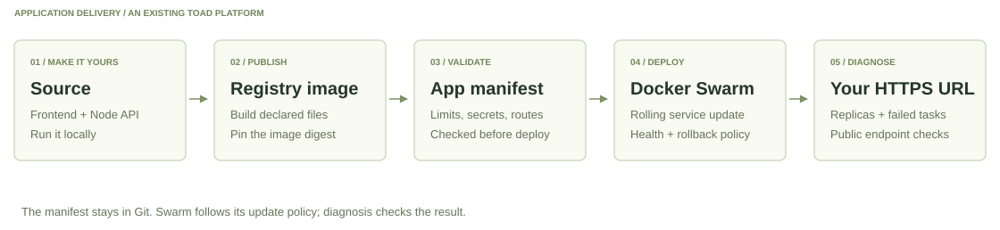
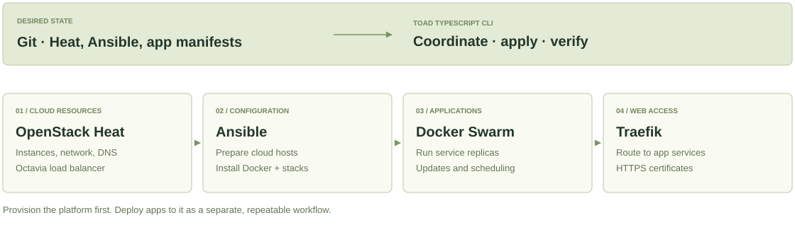

# See how TOAD fits together

Follow the application from your editor to a public URL, then look beneath it
at the cloud platform. These are two different workflows: shipping an app to
an existing platform does not provision new cloud resources.

## From source to HTTPS

1. **Create and edit.** Start with the frontend and Node API template. Run it
   locally before paying for cloud resources.
2. **Publish.** Build only the files declared in `build.yaml`, push to your
   registry, and pin the returned image digest in Compose.
3. **Validate.** Check the manifest, file allow-list, image digests, memory
   limits, security settings, and rollback policy.
4. **Deploy.** Swarm rolls out the desired service state. The update policy
   requests rollback when a rollout fails its checks.
5. **Diagnose.** Inspect running replicas, failed tasks, and public HTTPS
   checks. A successful rollout still needs application-specific validation.

[Try locally](QUICKSTART.md) · [Follow the complete first-app recipe](FIRST-APP.md)

## Four tools, four jobs

Git stores desired state; the TypeScript CLI coordinates the tools and reports
what happened. Credentials stay in the selected operator context, outside the
public source and operator image.

The maintained production profile uses three Swarm managers behind an Octavia
load balancer. Traefik runs **one replica** with a pinned local certificate
store. Three managers preserve control-plane quorum after one manager loss;
they do not remove the ingress or local-storage availability limits.

The [production request-routing diagram](DEPLOYMENT.md#what-gets-deployed)
shows public users, DNS, Octavia, the managers, Traefik, application stacks,
and the separate mTLS requirement for admin interfaces. Public app routes need
their own authentication when their data or actions require it.

## Observe, update, recover

The [operations diagrams](OPERATIONS.md) cover the health investigation loop,
deployment states, and encrypted volume capture. Stateless apps can run
multiple replicas; local stateful volumes remain attached to one node and need
an explicit backup and recovery policy.

The [recovery diagrams](DISASTER-RECOVERY.md) show the three independent inputs:
desired state in Git, operator escrow, and encrypted data archives. Offsite
storage must be configured separately. The fresh-cluster recovery drill remains
pending, so these diagrams describe the procedure, not a measured recovery-time
or data-loss guarantee.

[Choose a storage profile](STATEFUL-STORAGE.md) ·
[Read the validation record](LAUNCH-READINESS.md)
