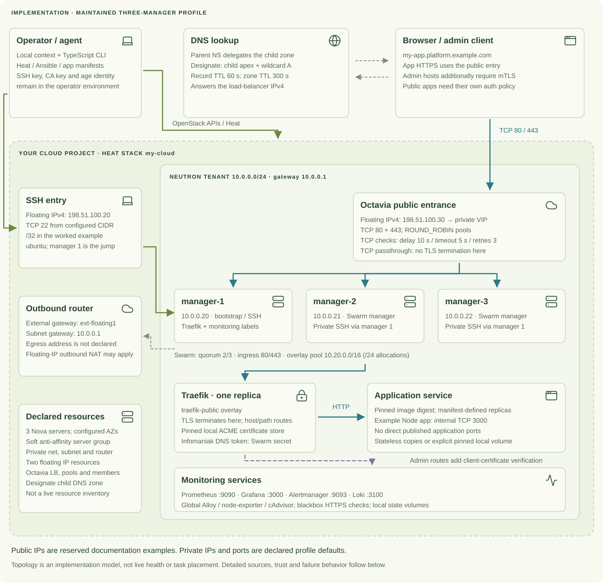

# TOAD implementation map

This is the detailed explanation of the **maintained three-manager IPv4
profile**, reviewed against runtime source at
[bfaa413](https://github.com/RemiGirard/TOAD-infra/tree/bfaa413) on 28 October 2026.
It describes declarations and control flow, not the current health or resource
inventory of your account. Public `198.51.100.x` addresses are reserved examples;
private addresses below are the template's defaults.

The same implementation can be read in the homepage's **Expert** level.
Start with [the evolving diagram](https://toad.remigirard.dev/#whole-picture) or the
[complete Infomaniak recipe](INFOMANIAK-EXAMPLE.md) for the runnable setup.

## Network and runtime

### Resource and address ownership

| Boundary | Declaration and effect |
|---|---|
| Provider | Infomaniak is the verified path. The workflow needs Keystone, Heat, Nova, Neutron, Octavia and Designate, plus Infomaniak parent-DNS and DNS-01 integrations. Another OpenStack provider needs adaptation and verification. |
| Heat resource group | Three Nova managers, a soft-anti-affinity server group, tenant network/subnet/router, security groups, two explicit floating-IP resources, Octavia resources and a Designate zone/records. Provider-managed internals are not enumerated by this diagram. |
| Placement | Availability-zone parameters default to `az-1`, `az-2`, `az-3`. They must exist in the chosen region. Soft anti-affinity and AZ names do not establish a measured failure-domain guarantee. |
| Tenant network | `10.0.0.0/24`, gateway `10.0.0.1`; managers `10.0.0.20`, `.21`, `.22`. VM resolver defaults are `1.1.1.1` and `9.9.9.9`. |
| App public entry | Octavia's floating IPv4, `198.51.100.30` in the example, is bound to its VIP port. The private VIP is provider assigned. App DNS resolves to this public address. |
| Operator public entry | Manager 1's floating IPv4, `198.51.100.20` in the example. Inventory uses it directly for manager 1 and an explicit OpenSSH ProxyCommand through it for the other private managers. The generated inventory is private, mode `0600`. |
| Outbound networking | The Neutron router has an external gateway on the configured public network. Its provider-assigned public address is separate from the two floating-IP resources. `198.51.100.40` is only an example of this third role. |

### Allowed paths and routing

| Path | Exact current declaration |
|---|---|
| Public SSH | TCP `22` from `ssh_allowed_cidr` on manager 1. The worked recipe uses the operator workstation's public `/32`; the parameter is a configurable IPv4 CIDR. |
| Private SSH / web | TCP `22`, `80`, `443` from `10.0.0.0/24`. The web rule admits that subnet, not a source identity restricted exclusively to Octavia. |
| Swarm internode | TCP `2377`; TCP and UDP `7946`; UDP `4789`; ICMP from the tenant subnet. IPv4 egress is allowed. |
| Swarm overlay | Initialization uses the disjoint `10.20.0.0/16` default address pool with `/24` allocations. `traefik-public` is an attachable overlay. The creation command does not request encrypted overlay data traffic. |
| Public HTTP / HTTPS | Octavia has separate TCP listeners/pools on `80` and `443`, each with all three manager addresses as members. Both use `ROUND_ROBIN` and TCP health monitors with a 10-second delay, 5-second timeout and 3 retries. These are connection checks, not app-release checks. |
| Routing mesh | Traefik publishes `80`/`443` in Swarm ingress mode. A connection accepted at any manager can reach the single Traefik task through the routing mesh. The map does not imply one Traefik task per node. |
| TLS boundary | Octavia passes TCP through. Traefik terminates browser TLS, redirects HTTP to HTTPS and selects a service using router labels. Backend encryption is not asserted by this diagram. The Node example uses internal port `3000`; other services declare their own port. |
| Certificates | The Traefik stack configures `letsencrypt` HTTP-01 and `infomaniak` DNS-01 resolvers. Router labels select the resolver. Generated apps and bundled admin routes default to `letsencrypt`; specific apps, including this project site, select `infomaniak`. |
| DNS | The Designate zone has a 300-second TTL; its apex and wildcard A records use 60 seconds and point to the load-balancer floating IP. Manual parent NS delegation tells resolvers where the child zone lives. Parent apex/wildcard A synchronization is a separate operation. DNS never proxies the page. |

Traefik is **one replica**, placed on the manager labelled
`toad.traefik-certificates=true` by its deployment playbook. Its certificate
store is a local named volume. Three healthy managers do not make this ingress
state highly available. Application tasks use the external `traefik-public`
network; application manifests cannot expose their own published host ports.

Sources: [Heat profile](https://github.com/RemiGirard/TOAD-infra/blob/bfaa413/openstackV3/heat/level5-production.yaml),
[Swarm initialization](https://github.com/RemiGirard/TOAD-infra/blob/bfaa413/ansible/playbooks/initJoinSwarm.yaml),
[inventory generation](https://github.com/RemiGirard/TOAD-infra/blob/bfaa413/openstackV3/scripts/presentation/pages/inventory.ts),
[Traefik stack](https://github.com/RemiGirard/TOAD-infra/blob/bfaa413/router/docker-compose.yaml).

## Provisioning and desired state

1. **Select a context.** `cloud init NAME` creates/selects local templates;
   it does not create cloud servers. Operator credentials and environment
   configuration remain outside public source. An application's source can
   stay in its own repository.
2. **Review configuration.** `cloud plan STACK` is a local review reporting the
   intended three managers, load balancer and DNS zone. It is not an OpenStack
   change-set, a price quote or an approval. Human approval is an agent/human
   workflow requirement; the CLI has no universal `approve` command.
3. **Apply.** With an explicit stack target, preflight and Heat validation run,
   then cloud resources are created/updated. TOAD generates inventory and runs
   Docker installation, host hardening, Swarm initialization, Traefik, root
   service, monitoring and platform-hello playbooks.
4. **Handle first DNS delegation.** All those platform playbooks have run before
   a missing delegation produces `waiting_for_dns`, exit code `2`, and operation
   state `waiting`. Keep the stack and resources; add the actual child NS records
   at the parent provider. Do not create a second stack to retry this stage.
5. **Resume and verify.** Resume validates the checkpoint's stack UUID and parent/
   child domain binding. It completes DNS synchronization and platform checks;
   it does not repeat the platform provisioning sequence.

Current apply synchronizes the parent apex and wildcard A records as well as
the child zone. Those changes can move an existing website. The worked example
therefore uses a dedicated domain and an explicit resource/DNS plan.
Keep the existing admin CA when updating an existing stack; missing escrow is
not permission to replace its trusted CA.

Sources: [cloud commands](https://github.com/RemiGirard/TOAD-infra/blob/bfaa413/openstackV3/scripts/presentation/pages/cloud.ts),
[apply / checkpoint / resume](https://github.com/RemiGirard/TOAD-infra/blob/bfaa413/openstackV3/scripts/presentation/pages/apply.ts),
[parent DNS synchronization](https://github.com/RemiGirard/TOAD-infra/blob/bfaa413/openstackV3/scripts/presentation/pages/dns.ts),
[agent operating contract](../AGENTS.md).

## Application releases

**Source → allow-listed build → registry image → immutable Compose reference →
Swarm service → running-task proof → declared HTTPS checks.**

| Stage | What changes, and what does not |
|---|---|
| Existing-repo `init NAME` | Writes `toad.yaml`, `compose.toad.yaml` and build metadata for a tagged build target. Existing TOAD metadata is refused. The initial tagged-build service is a routing placeholder; an existing immutable input image can skip a local build. The command is top-level `init`, not `app init`. |
| `app publish` | Stages only allowed build files, executes Buildx with push, requires the resulting SHA-256 digest, then updates the Compose image/routed port and saved image/platform defaults. It does not provision, deploy or change DNS. Multiple services require explicit service selection. |
| `app validate` | Enforces the manifest, declared-file boundaries, immutable images, memory limits, rollback policy, `no-new-privileges` and Traefik ingress. Privileged/host-namespace containers, added capabilities, Docker socket mounts and direct published application ports are rejected. Validation is not an application security proof. |
| `app deploy` | Validates/snapshots declared ordinary files, rejects changed Compose, deploys declared secrets, transfers the bundle, and runs `docker stack deploy --prune` on the existing platform. Then it checks runtime convergence and declared endpoints. |
| `app release` | Composes publish → validate → deploy. Deploy already performs release/HTTPS verification; release does not invoke the fuller `diagnose` collector. |
| `app diagnose` | Adds read-only release/task/endpoint diagnosis, sanitized failed-task categories and actionable hints. An empty check list performs no HTTPS validation. |
| `app rollback` | Requires immutable previous service images, requests and verifies recovery, and writes a unique private image patch. Compose/Git stay unchanged. Review/apply the patch to accept the recovered image as desired state, or a later deploy can request the bad image again. |

Release proof compares the **requested digest**, the **service-spec digest**
and **every running-task digest**, along with declared replicas, ready task
counts and update/rollback state. Outcomes are `deployed`, `pending`,
`rolled_back` or `failed`. An HTTP 200 from a recovered old release cannot
establish that the requested new image shipped.

App data is separate from replication. A local named-volume service requires
one replica, a pinned stateful node and explicit volume/backup declarations.
`backup: none` is a valid declaration; it is not recovery evidence. Cinder,
object/external storage and distributed data need their own implementation,
application integration and tests. The current local-volume contract does not
provide automatic data replication or node-loss failover.

Sources: [existing-repo init](https://github.com/RemiGirard/TOAD-infra/blob/bfaa413/openstackV3/scripts/presentation/pages/project.ts),
[build and publish](https://github.com/RemiGirard/TOAD-infra/blob/bfaa413/openstackV3/scripts/infrastructure/app-image.ts),
[release / deploy / rollback](https://github.com/RemiGirard/TOAD-infra/blob/bfaa413/openstackV3/scripts/presentation/pages/app.ts),
[runtime digest proof](https://github.com/RemiGirard/TOAD-infra/blob/bfaa413/openstackV3/scripts/infrastructure/app-runtime.ts),
[manifest policy](https://github.com/RemiGirard/TOAD-infra/blob/bfaa413/openstackV3/scripts/infrastructure/app-manifest.ts),
[storage choices](STATEFUL-STORAGE.md).

## Trust and secrets

| Boundary | Current implementation |
|---|---|
| Operator | Holds OpenStack credentials, SSH key, admin CA private key and age identity. Use the selected private operator context; the public project site never reads it. |
| Platform certificate automation | The restricted Infomaniak DNS token becomes a content-addressed immutable Swarm secret. Traefik reads it from a secret file. It is intentionally delivered to the cluster. |
| App secrets | Age ciphertext is decrypted operator-side, then streamed into content-addressed Swarm secrets mounted as files for declared services. Secrets are not all local-only. |
| Admin TLS | Traefik's `admin-mtls@file` option has TLS 1.2 minimum, strict SNI and `RequireAndVerifyClientCert`. The cluster gets the public client CA, not the CA private key. Default client lifetime is 90 days, configurable within 1–397 days. |
| Admin versus app access | Admin routes share the public HTTPS entry but add client-certificate verification. They are not VPN-only. App routes do not inherit that requirement automatically; app-user authorization remains an application decision. |
| Root-equivalent access | Swarm-manager access and Docker socket access are privileged trust boundaries. Traefik and Alloy use the Docker socket as part of the platform. Application manifests reject that mount. |
| Existing trust | Restore the existing CA/bundle from escrow. Never rotate trust, restore data, reboot nodes or destroy stacks merely to get a diagram or diagnosis to succeed. |

Sources: [security policy](../SECURITY.md),
[DNS-secret deployment](https://github.com/RemiGirard/TOAD-infra/blob/bfaa413/ansible/playbooks/deployTraefik.yaml),
[admin TLS option](https://github.com/RemiGirard/TOAD-infra/blob/bfaa413/router/dynamic.yaml),
[PKI generation](https://github.com/RemiGirard/TOAD-infra/blob/bfaa413/openstackV3/scripts/infrastructure/admin-pki.ts),
[app secret transfer](https://github.com/RemiGirard/TOAD-infra/blob/bfaa413/openstackV3/scripts/infrastructure/app-secrets.ts).

## Monitoring and operation evidence

Prometheus scrapes and evaluates every **30 seconds**. It discovers Traefik
metrics on `9100`, node-exporter on `9100`, cAdvisor on `8080`, Alloy on `12345`
and Loki on `3100`; the different `9100` endpoints have different service DNS
names. Blackbox exporter on `9115` probes the bundled public platform URLs.
Alloy discovers local Docker containers and pushes their labelled logs to Loki.

Prometheus (`9090`), Grafana (`3000`) and Alertmanager (`9093`) have protected
Traefik admin routes. Loki and the collectors are internal services. Stateful
monitoring components use the manager labelled `toad.monitoring-state=true`;
Alloy, node-exporter and cAdvisor are global services. Prometheus retention is
7 days with a 5 GB size limit. Notification destinations and successful delivery
need explicit configuration and validation.

| Evidence channel | Exact scope |
|---|---|
| `observe` | Swarm node identity/address/role/state/reachability/availability/leader, app release evidence, declared HTTPS results, sanitized task issues, authenticated Prometheus target/alert counts and local operation history. |
| Capture time | `generatedAt` is set before collection. Expiry is 60 seconds from that start, so slow collection can already be stale when it finishes. |
| Watch cadence | Waits 15 seconds after collection, then collects again. The private page reloads every 15 seconds. This does not promise observations are always 15 seconds old. |
| Missing access | Explicit gaps / unknown state, not zero alerts or a healthy infrastructure claim. |
| Overall `ok` | Requires no gaps, at least three managers all ready/reachable, successful observed apps, nonempty healthy monitoring targets and zero firing alerts. |
| Local operation journal | Newest 20 context operations, identities, coordinator host/PID, local worker PIDs, timestamps and phase events. This is not a cross-machine audit service. |
| Interrupted lock | Reconciliation checks process ownership and acknowledges interruption. It does not undo or resume arbitrary remote changes. |

The explanatory route is not a discovered DNS, load-balancer, container-placement,
storage or backup graph. The HTML export does not contain raw logs or time-series
charts. Notification delivery remains unverified by that observation. Keep the
private `0600` export off public hosting and use declared checks plus app-specific
tests to assess a release.

Sources: [monitoring stack](https://github.com/RemiGirard/TOAD-infra/blob/bfaa413/monitoring/docker-compose.yaml),
[Prometheus configuration](https://github.com/RemiGirard/TOAD-infra/blob/bfaa413/monitoring/prometheus.yml.j2),
[Alloy log collection](https://github.com/RemiGirard/TOAD-infra/blob/bfaa413/monitoring/alloy/config.alloy),
[observation collection](https://github.com/RemiGirard/TOAD-infra/blob/bfaa413/openstackV3/scripts/infrastructure/observation.ts),
[watch/export handler](https://github.com/RemiGirard/TOAD-infra/blob/bfaa413/openstackV3/scripts/presentation/pages/observe.ts),
[operation journal](https://github.com/RemiGirard/TOAD-infra/blob/bfaa413/openstackV3/scripts/infrastructure/operation-lock.ts).

## Failure boundaries and recovery

| Event or design choice | What the architecture does and does not provide |
|---|---|
| One manager unavailable | Two of three managers can retain control-plane quorum. This does not establish that ingress, every app or every dataset remains available. |
| Pinned ingress host lost | One Traefik replica plus its local ACME store is an ingress availability limit. Restoring trust/state and scheduling is separate from preserving Swarm quorum. |
| Monitoring state host lost | Pinned monitoring volumes have a node-local recovery boundary. A dashboard's previous green state is not proof the current platform is reachable. |
| Stateful app host lost | One pinned replica and local volume need a restore/replacement procedure; Swarm replicas do not synchronously copy that data. |
| Bad app release | Automatic rollback can recover the old image. Delivery of the requested new digest is still unsuccessful. |
| Backup declared | A policy field or captured archive does not prove offsite delivery, application consistency or a successful restore. The fresh-cluster app-recovery drill remains pending. |
| Very small servers | Manager 1's declared monitoring-container memory limits sum to `2176M` in Compose notation before OS, Docker, Traefik and apps. That is a sum of limits, not measured usage or a validated minimum flavor. |
| More capacity | App replicas can be changed within existing capacity. The maintained workflow does not automatically provision extra workers, migrate local data or turn the proposed one-node IPv6 design into the three-manager profile. |

Recovery has three independent inputs: desired state in Git, private operator
escrow, and encrypted data archives. Restore only the exact human-approved
target. See [the recovery procedure](DISASTER-RECOVERY.md),
[storage profiles](STATEFUL-STORAGE.md), [costs and growth](COSTS.md) and
[the validation record](LAUNCH-READINESS.md). No recovery-time or data-loss
guarantee is inferred from this drawing.
