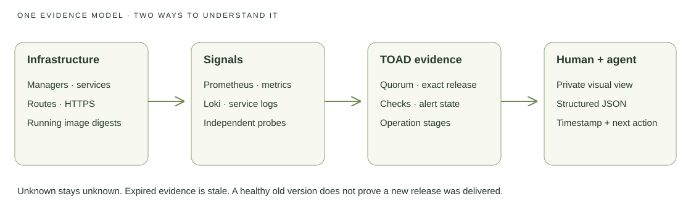

# Understand what your infrastructure and agent are doing

TOAD gives a person and their coding agent the same evidence: manager quorum,
requested and running application images, HTTPS checks, metric and alert state,
and the stages of the current operation. The agent uses JSON; you can open a
private visual view generated from that same observation.



## Open your private operation view

From `openstackV3`, in the intended operator context:

```sh
pnpm run observe -- --context my-cloud --app my-app --output /private/path/toad-view.html
pnpm run observe -- --context my-cloud --app my-app --json
```

Open the generated HTML file locally. To keep it current while an agent works:

```sh
pnpm run observe -- --context my-cloud --app my-app --output /private/path/toad-view.html --watch
```

The collector refreshes the file every fifteen seconds, after collection
finishes; the page reloads it. Each observation has a capture time and a
one-minute expiry. Slow collection, a stopped collector, or unavailable access
can make evidence stale. A point-in-time export is not a continuous monitoring
service. Keep the operator running if you need this local view to refresh.

The file is created with mode `0600` and contains private topology and release
information. Keep it off public hosting, Git, tickets, and shared folders.
The public project's interactive examples are explicitly illustrative; they
never load your cluster credentials or private state.

## Read the view

| Area | What it proves | What it does not prove |
|---|---|---|
| Managers | Readiness, reachability, role and quorum at capture time | Application data replication or future availability |
| Application release | Expected image digest versus service and running-task digests; update state; declared replicas | Correct business behavior beyond declared checks |
| HTTPS checks | Declared endpoints returned the expected status over validated TLS | Every app workflow works |
| Metrics and alerts | Authenticated Prometheus target and firing-alert state | An alert reached a person |
| Operation timeline | Local operation ID, coordinator, workers and fixed phase names | Every remote action was undone if the coordinator stopped |
| Evidence gaps | Which observations could not be collected | That missing observations are healthy |

A healthy old release after automatic rollback is reported as a failed delivery
of the requested new release. To accept a recovered release as desired state,
review and apply the generated Compose patch. `app diagnose` then compares
against that explicit desired state.

## Monitoring layers

Prometheus receives host, container, ingress and public-probe metrics. Loki
receives service logs through Alloy. Grafana's protected overview includes
signal flow, CPU, memory, disk, HTTP behavior, scrape age, and recent logs.
Use `app logs APP --follow --since 15m --tail 100` for a focused investigation.

Admin interfaces remain behind mTLS. Missing the original operator certificate
or key makes those observations unknown; restore the original identity from
escrow. Do not create a replacement CA to make a dashboard turn green.

The Swarm-hosted monitor shares the platform's failure domain. Run the existing
external HTTPS probe independently to detect total platform outages. See
[monitoring configuration](../monitoring/README.md).

Alertmanager initially uses a dashboard-only receiver. Outbound alert delivery
and the offsite backup notification need a chosen destination and an actual
test. The operation view explicitly does not claim notification delivery.
See [backup automation](BACKUP-AUTOMATION.md) for the existing secret-backed
notification and remote verification workflow.

## Follow or reconcile an agent operation

```sh
pnpm run operation -- status --context my-cloud --json
pnpm run operation -- history --context my-cloud --json
```

Mutation history records stage names and process ownership, not command
arguments, secret values or raw service logs. Records live privately in the
selected context's `operations/` directory; they are local operator evidence,
not a cross-machine audit service.

An interrupted coordinator's lock is retained. Inspect worker processes and
remote cloud/Swarm state before acknowledging it:

```sh
pnpm run operation -- reconcile --context my-cloud --acknowledge-interrupted
```

Reconciliation refuses a live coordinator or recorded worker. Acknowledging
interrupted work does not undo or resume any remote mutation. Diagnose again,
then choose the narrowest authorized next action. Never start another deploy
because a caller stopped waiting.
