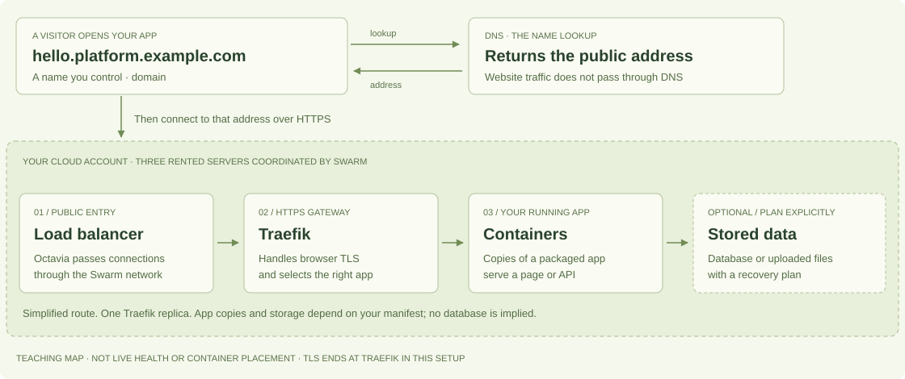

# Your app online, without the infrastructure vocabulary

You built something on your computer. To let other people use it, it needs
an address, somewhere to run, and a way to reach the right app securely.
TOAD helps prepare those parts in your cloud account. You can work with a
coding agent; you still choose the costs, access and responsibilities.

**Not sure you want to operate a cloud platform?**
[Compare the responsibilities first](#choose-your-level-of-responsibility).
You can also [preview the example locally](LOCAL-STARTER.md) without buying
cloud resources.

## Follow one visit to your app

This is a teaching map of the maintained TOAD setup, not a reading of your
account or a health report. The public homepage lets you select each part
for an explanation. No account or credentials are needed to explore it.

1. A visitor opens **hello.platform.example.com**.
2. Their browser asks **DNS** for the name's address. DNS returns the public
   load-balancer address; it does not carry the website traffic.
3. The browser connects to that address over **HTTPS**. The load balancer
   passes the connection through the servers' Swarm network to **Traefik**.
4. Traefik handles the encrypted browser connection and routes the request
   to the right running app. Encryption ends here in this setup; the diagram
   does not claim encrypted backend connections.
5. The app returns the page or API result. It accesses a database or files
   only if your app and its deployment have been configured to use them.

## The names, in ordinary language

| Term | Think of it as | What you need to decide |
|---|---|---|
| Domain | The name you control, such as `example.com`. An app can use a name below it, such as `hello.platform.example.com`. | Which name to use and who maintains its registration. It is separate from renting servers. |
| DNS | A lookup that finds the public address for a name. | Which zone TOAD manages. Its first setup needs a one-time child-zone delegation; your agent can explain the exact records. |
| Public cloud | Computers, networking and storage rented through your provider account. OpenStack is the API family TOAD uses to manage resources. | Owner, region, capacity, costs and access. Infomaniak is TOAD's verified path; other providers need adaptation and validation. |
| Server / VM | One rented computer that runs part of your platform. | The maintained profile uses three. Three managers protect coordination after one manager loss, not every app or dataset. |
| Load balancer | The platform's public front door, distributing connections to its servers. | Resource costs and routing. Octavia passes TCP connections through in this setup. |
| HTTPS / TLS | Encryption for the connection from a visitor's browser to your HTTPS gateway. “SSL” is the older name people often use. | Your domain and certificate setup. HTTPS does not add app login or make insecure app code safe. |
| Traefik | The gateway that handles HTTPS certificates and selects the app for a hostname or path. | TOAD runs one replica with a local certificate store; ingress has an availability limit. |
| Image / container | The packaged app and runtime dependencies / a running copy of that package. | Your app's build, port and configuration. Your agent can prepare these from your source. A running copy is also called a replica. |
| Registry | A place to publish and retrieve app images. | Which registry and access policy to use. TOAD pins the exact image digest so a release identifies specific content. |
| Volume / backup | Files kept beyond a container's lifetime / an independent recoverable copy of data. | A database is not supplied automatically. Local volumes stay on one chosen node; offsite backup and a tested restore need explicit setup. |

## What you have after each stage

| Stage | The result you should be able to see | What has not happened yet |
|---|---|---|
| Account and project access | An owned project, dedicated OpenStack access and local private configuration. | Creating access does not provision your platform. A domain is a separate prerequisite. |
| Platform applied and verified | Three managers, public load balancer, DNS routing, HTTPS gateway and monitoring configured; a platform verification result. | Your own app has not shipped. Verification is evidence at a point in time. |
| App released and diagnosed | Your app URL, intended versus running image, ready replicas and declared HTTPS check results. | Passing endpoint checks does not prove every feature works or that data is recoverable. |
| Operations prepared | A private view of nodes, releases, checks and agent operation stages; agreed maintenance and recovery procedures. | An open dashboard does not prove alerts reached someone. Backups need independent copies and restore validation. |

Use the [account guide](CLOUD-ACCOUNT.md), then the
[cloud-first quickstart](QUICKSTART.md). Reuse an existing verified platform
when you have one; each new app does not need another three-server platform.

## See your own infrastructure, privately

After setup, ask your agent:

> Open TOAD's private operation view for the selected context and my app.
> Explain the observed servers, running app copies and HTTPS checks in plain
> language. Show the capture time and anything unknown. Distinguish the route
> illustration from collected health evidence.

The [operation view](OBSERVABILITY.md) draws a routing model and shows the
actual observed servers and services for the selected context/app. It does
not discover a complete DNS, load-balancer, container-placement or data map.
Those parts must not turn green just because the illustration has arrows.

The generated HTML stays on your operator machine. With the local collector
running in `--watch` mode it refreshes; observations expire after one minute.
It contains private details and should not be published with the project site.

Admin dashboards are a different surface: they use the public HTTPS gateway
with an additional client-certificate requirement, called mTLS. This is not
the same thing as app-user authentication or a VPN-only network.

## Choose your level of responsibility

There is no universal winner. This compares the normal workflows, not prices,
every feature or every paid plan. Provider documentation was reviewed on
**28 October 2026**; check current limits and costs for your app.

| Approach | Where your app runs | What is convenient | What you still operate or decide |
|---|---|---|---|
| Hosted app platform, such as Render or Railway | On the provider's managed deployment platform. | Connect a repository or image and configure a service. Render supplies a public service URL and managed TLS; Railway builds/deploys services from source or images. | App behavior, configuration, data policy, access and billing. Supported runtimes, limits and deployment models follow the provider. |
| Platform on your servers, such as Coolify | On servers you provide and control. | Dashboard/API workflows for builds, deployments, domains and service operations. | Your servers, workload security, data and backups. Self-hosting also means running the Coolify control plane; Coolify Cloud manages that control plane separately. |
| Your cloud defined in Git, with TOAD | In your OpenStack-based cloud project; currently verified on Infomaniak. | Provision the platform and use the same local CLI for human or agent delivery, diagnosis and evidence. | Cloud account, domain, server/platform upkeep, capacity, app security, costs, notifications, backups and tested recovery. |

Sources: [Render web services](https://render.com/docs/web-services),
[Railway's building blocks](https://docs.railway.com/overview/the-basics),
[Coolify's model](https://coolify.io/docs/core/what-is-coolify) and
[Coolify Cloud responsibilities](https://coolify.io/docs/start-with-cloud).

**Want to share an app while handing server operation to a provider?**
Start by evaluating a hosted platform against your app's requirements.
**Want your own servers with a dashboard?** Compare the bring-your-server
approach. **Want a declared cloud platform you and your agent can inspect and
operate together?** Review TOAD's [costs](COSTS.md),
[availability and data limits](ARCHITECTURE.md), then start with
[account and access](CLOUD-ACCOUNT.md).

An agent reduces manual work in any of these models. It does not take
ownership of the account, pay the bill, validate your application security
or guarantee recovery for you.
